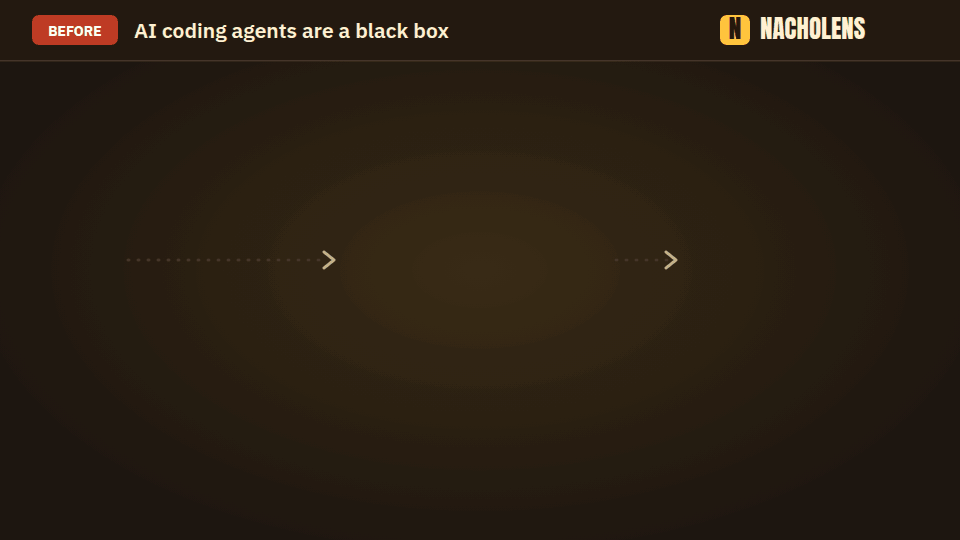

# nacholens

[English](README.md) · [日本語](README.ja.md) · **Deutsch** · [Français](README.fr.md) · [中文](README.zh.md) · [한국어](README.ko.md)

**Sieh, was eine KI an deinem Code geändert hat, ohne den Code zu lesen.**



Ein KI-Agent ändert deinen Code und liefert einen langen Diff. Was wurde angefasst? Gibt es neue externe Aufrufe? Was muss neu getestet werden? nacholens antwortet mit einem Bild zum Abspielen:

- **Wähle, was ein Nutzer tut** (anmelden, bestellen). Ein Punkt wandert Schritt für Schritt vom Browser durch Dienste, Datenbank und externe Dienste.
- **Was sich geändert hat, ist farbig**: gelb = geändert, grün = neu.
- **Jeder Schritt verweist auf den echten Code**, nichts wird geraten.

Für Planer, Tester und Entwickler. Code lesen musst du nicht.

## In 3 Schritten nutzen

1. Öffne deinen KI-Coding-Agenten (Claude Code, Codex, Cursor, …) im Projekt.
2. Kopiere den Block unten, schreibe in `Meine Anfrage:`, was du sehen willst, und füge ihn ein.
3. Öffne die Seite, die der Agent dir gibt.

```text
Nutze nacholens, um meine Anfrage unten zu diesem Repository als Seite zu beantworten, die ich öffnen kann.

Meine Anfrage: <hier schreiben, was du sehen willst>
Tiefe (optional): 1 nur Änderungen · 2 Überblick · 3 Details (Tabellen und Innenleben). Ohne Angabe wähle nach meiner Anfrage und sag mir, welche.

So geht's:
1. Hole das nacholens-Playbook und die CLI (braucht Node.js 24+ und git; in dieses Repository wird nichts installiert):
   npx -y @mafianacho/nacholens@latest install --to "$HOME/.nacholens-skill" --force
2. Lies "$HOME/.nacholens-skill/nacholens/SKILL.md" und folge ihm. Die CLI ist:
   node "$HOME/.nacholens-skill/nacholens/cli/src/cli.js" <command>
3. Ändere keine Datei dieses Repositorys außer dem Modell in .nacholens/. Schreibe die Seite nach ./nacholens-out.
4. Wenn die Seite fertig ist, nenne mir ihren Pfad und erkläre in einfachen Worten, was sie zeigt.
```

Das kannst du fragen:

- `Was hat sich in den letzten 5 Commits geändert, und was sollte ich erneut testen?`
- `Zeig, wie die Anmeldung funktioniert, vom Browser bis zur Datenbank.`
- `Vergleiche diesen Branch mit main: Welche Abläufe hat diese Arbeit berührt?`
- `Erkläre PR #12 direkt im PR: Bilder, geänderte Abläufe und was erneut zu testen ist.`

## In deinem Pull Request

nacholens schreibt auch **einen Kommentar im Pull Request**, den Reviewer allein auf der PR-Seite verstehen: Bilder der geänderten Abläufe, jeder Schritt einfach erklärt mit Link zum Code, eine Test-Checkliste und was die Bilder nicht abdecken. [So funktioniert es](docs/pr.md)


## Ohne eigenes Projekt ausprobieren

```bash
npx -y @mafianacho/nacholens@latest demo
# → ./nacholens-demo/demo-shop.html (im Browser öffnen)
```

## Gut zu wissen

- Dein Projekt wird nur gelesen, nie verändert. nacholens selbst sendet nichts übers Netz.
- Kein Konto, kein Server: nur Node.js 24+ und git.

## Mehr

[Anleitung](docs/guide.md) (Englisch) · [Agenten-Playbook](skills/nacholens/SKILL.md) · [Modellformat](docs/model-schema.md) · [Review-Dock](docs/review.md) · [PR-Kommentar](docs/pr.md) (Englisch) · [Mitwirken](CONTRIBUTING.md) · [Sicherheit](SECURITY.md)

Apache License 2.0 ([`LICENSE`](LICENSE), [`NOTICE`](NOTICE)). Eingebettete Schriften: SIL Open Font License 1.1 ([`FONTLOG`](src/player/fonts/FONTLOG.md)). Made by [Mafianacho Inc.](https://mafianacho.com)
