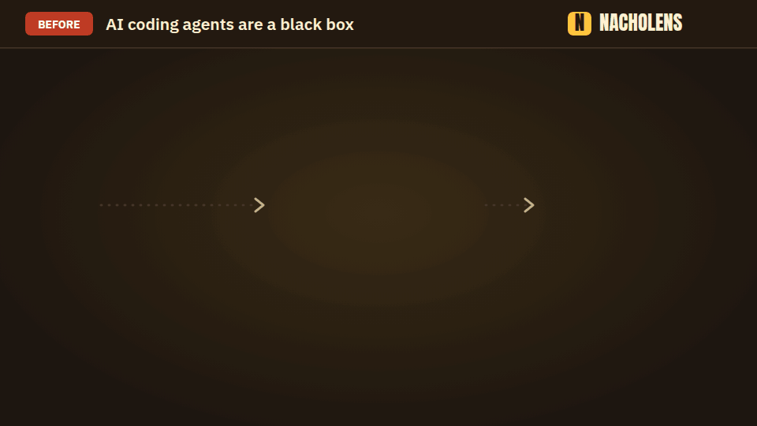
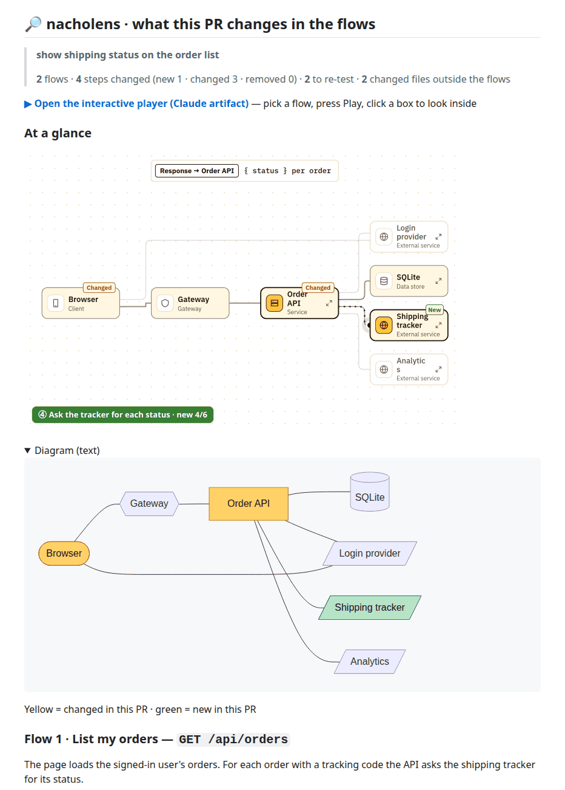

# nacholens

[](https://www.npmjs.com/package/@mafianacho/nacholens) [](https://github.com/mafianacho/nacholens/actions/workflows/ci.yml) [](LICENSE)

[English](README.md) · **日本語** · [Deutsch](README.de.md) · [Français](README.fr.md) · [中文](README.zh.md) · [한국어](README.ko.md)

**AIがコードに加えた変更を、コードを読まずに確かめられます。**



AIエージェントがコードを変更し、長い差分を返してきます。何に触れたのか、外部サービスを呼ぶようになったのか、何を再テストすべきか。nacholens は、再生できる図で答えます。

- **ユーザーの操作を選びます**（ログイン、注文）。点がブラウザからサービス、データベース、外部サービスへと1ステップずつ進みます。
- **変更箇所は色で分かります**：黄 = 変更、緑 = 新規。
- **どのステップも実際のコードを指す**ので、推測はありません。

企画担当、テスター、開発者の誰でも使えます。コードを読む必要はありません。

## 3ステップで使う

1. プロジェクトで AI コーディングエージェント（Claude Code、Codex、Cursor など）を開きます。
2. 下のブロックをコピーし、`依頼:` の行に見たいことを書いて貼り付けます。
3. エージェントが教えてくれるページを開きます。

```text
nacholens を使って、このリポジトリについての下の依頼に、開けるページで答えてください。

依頼: <見たいことをここに書く>
深さ（任意）: 1 変更のみ・2 全体像・3 詳細（テーブルや内部まで）。書かなければ依頼に合わせて選び、どれにしたか教えてください。

手順:
1. nacholens の手順書と CLI を取得する（Node.js 24 以上と git が必要。このリポジトリには何もインストールしない）:
   npx -y @mafianacho/nacholens@latest install --to "$HOME/.nacholens-skill" --force
2. "$HOME/.nacholens-skill/nacholens/SKILL.md" を読み、その手順に従う。CLI は次のとおり:
   node "$HOME/.nacholens-skill/nacholens/cli/src/cli.js" <command>
3. .nacholens/ のモデル以外、このリポジトリのファイルは変更しない。ページは ./nacholens-out に書き出す。
4. ページができたら、そのパスを伝え、何が分かるかを平易な言葉で説明する。
```

こんなことを頼めます:

- `直近5コミットで何が変わった？何を再テストすべき？`
- `ログインの流れを、ブラウザからデータベースまで見せて。`
- `このブランチを main と比べて、この作業が触れたフローはどれ？`
- `PR #12 を PR の中で説明して：図、変わったフロー、再テストすること。`

## プルリクエストの中で

nacholens は**プルリクエストに1つのコメント**を書くこともでき、レビュアーは PR のページだけで内容を理解できます。変更されたフローの図、コードへのリンク付きでやさしい言葉にした各ステップ、再テストのチェックリスト、図がカバーしない範囲が入ります。[仕組み](docs/pr.md)



## 自分のプロジェクトなしで試す

```bash
npx -y @mafianacho/nacholens@latest demo
# → ./nacholens-demo/demo-shop.html（ブラウザで開く）
```

## 知っておくと良いこと

- プロジェクトは読み取るだけで、変更しません。nacholens 自体はネットワークに何も送信しません。
- アカウントもサーバーも不要です。Node.js 24+ と git だけで動きます。

## 詳しく

[ガイド](docs/guide.md)（英語） · [エージェント用手順書](skills/nacholens/SKILL.md) · [モデル形式](docs/model-schema.md) · [レビュードック](docs/review.md) · [PR コメント](docs/pr.md)（英語） · [コントリビュート](CONTRIBUTING.md) · [セキュリティ](SECURITY.md)

Apache License 2.0（[`LICENSE`](LICENSE)、[`NOTICE`](NOTICE)）。同梱フォント: SIL Open Font License 1.1（[`FONTLOG`](src/player/fonts/FONTLOG.md)）。Made by [Mafianacho Inc.](https://mafianacho.com)
