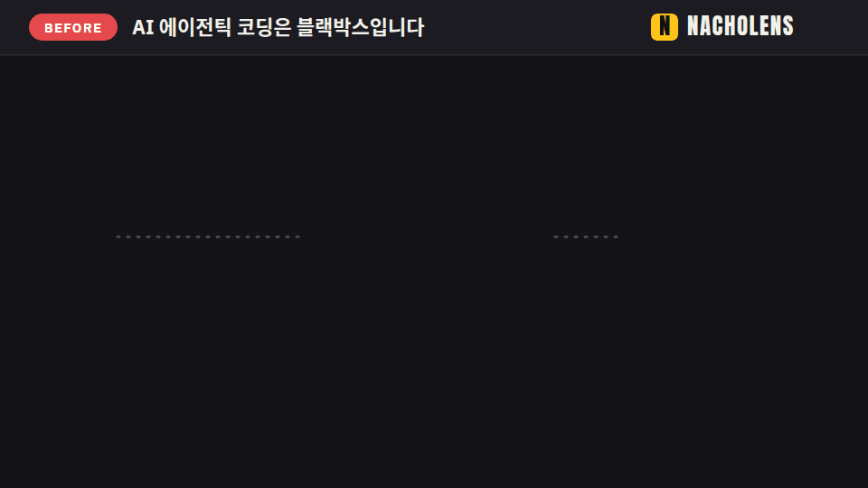

# nacholens

[](https://www.npmjs.com/package/@mafianacho/nacholens) [](https://github.com/mafianacho/nacholens/actions/workflows/ci.yml) [](LICENSE)

[English](README.md) · [日本語](README.ja.md) · [Deutsch](README.de.md) · [Français](README.fr.md) · [中文](README.zh.md) · **한국어**

**AI가 코드에서 무엇을 바꿨는지, 코드를 읽지 않고 확인하세요.**



AI 에이전트가 코드를 바꾸고 긴 diff를 돌려줍니다. 무엇을 건드렸을까요? 이제 외부 서비스를 호출할까요? 무엇을 다시 테스트해야 할까요? nacholens는 재생할 수 있는 그림으로 답합니다.

- **사용자가 하는 일을 고르세요** (로그인, 주문하기). 점 하나가 브라우저에서 서비스, 데이터베이스, 외부 서비스로 한 단계씩 움직입니다.
- **바뀐 곳은 색으로 보입니다**: 노랑 = 변경, 초록 = 신규.
- **모든 단계가 실제 코드를 가리키므로** 추측은 없습니다.

기획자, 테스터, 개발자 모두를 위한 도구입니다. 코드를 읽을 필요는 없습니다.

## 3단계로 쓰기

1. 프로젝트에서 AI 코딩 에이전트(Claude Code, Codex, Cursor 등)를 엽니다.
2. 아래 블록을 복사해 `요청:` 줄에 보고 싶은 것을 적고 붙여 넣습니다.
3. 에이전트가 알려 주는 페이지를 엽니다.

```text
nacholens로 이 저장소에 대한 아래 요청에, 열어 볼 수 있는 페이지로 답해 줘.

요청: <보고 싶은 것을 여기에 적기>
깊이(선택): 1 변경만 · 2 한눈에 · 3 자세히(테이블과 내부까지). 안 적으면 요청에 맞춰 고르고 알려 줘.

방법:
1. nacholens 플레이북과 CLI를 받는다 (Node.js 24 이상, git 필요, 이 저장소에는 아무것도 설치하지 않음):
   npx -y @mafianacho/nacholens@latest install --to "$HOME/.nacholens-skill" --force
2. "$HOME/.nacholens-skill/nacholens/SKILL.md" 를 읽고 그대로 따른다. CLI는 다음과 같다:
   node "$HOME/.nacholens-skill/nacholens/cli/src/cli.js" <command>
3. .nacholens/ 의 모델 말고는 이 저장소의 파일을 바꾸지 않는다. 페이지는 ./nacholens-out 에 만든다.
4. 페이지가 만들어지면 경로를 알려 주고, 무엇을 보여 주는지 쉬운 말로 설명한다.
```

물어볼 수 있는 것:

- `최근 커밋 5개에서 뭐가 바뀌었고, 무엇을 다시 테스트해야 해?`
- `로그인이 브라우저에서 데이터베이스까지 어떻게 흐르는지 보여 줘.`
- `이 브랜치를 main과 비교해서 이번 작업이 건드린 흐름을 알려 줘.`
- `PR #12를 PR 안에서 설명해 줘: 그림, 바뀐 흐름, 다시 테스트할 것.`

## PR 안에서

nacholens는 **PR에 코멘트 하나**를 쓸 수도 있어서, 리뷰어가 PR 화면만 보고 이해할 수 있습니다. 바뀐 흐름의 그림, 코드 링크가 달린 쉬운 말의 단계 설명, 다시 테스트할 체크리스트, 그림이 다루지 못하는 부분이 들어갑니다. [작동 방식](docs/pr.ko.md)


## 내 프로젝트 없이 해 보기

```bash
npx -y @mafianacho/nacholens@latest demo
# → ./nacholens-demo/demo-shop.html (브라우저로 열기)
```

## 알아 두면 좋은 것

- 프로젝트는 읽기만 하고 바꾸지 않습니다. nacholens 자체는 네트워크로 아무것도 보내지 않습니다.
- 계정도 서버도 필요 없습니다. Node.js 24+ 와 git 만 있으면 됩니다.

## 더 보기

[안내서](docs/guide.ko.md) · [에이전트 플레이북](skills/nacholens/SKILL.md) · [모델 형식](docs/model-schema.md) · [검토 독](docs/review.md) · [PR 코멘트](docs/pr.ko.md) · [기여하기](CONTRIBUTING.md) · [보안](SECURITY.md)

Apache License 2.0 ([`LICENSE`](LICENSE), [`NOTICE`](NOTICE)). 내장 글꼴: SIL Open Font License 1.1 ([`FONTLOG`](src/player/fonts/FONTLOG.md)). Made by [Mafianacho Inc.](https://mafianacho.com)
