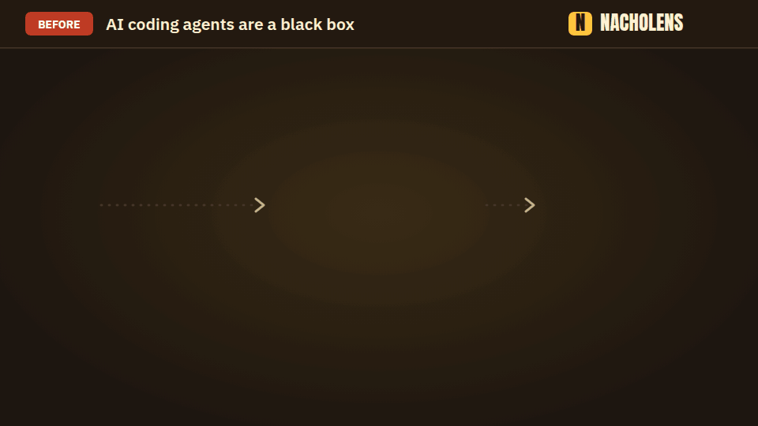

# nacholens

[](https://www.npmjs.com/package/@mafianacho/nacholens) [](https://github.com/mafianacho/nacholens/actions/workflows/ci.yml) [](LICENSE)

**English** · [日本語](README.ja.md) · [Deutsch](README.de.md) · [Français](README.fr.md) · [中文](README.zh.md) · [한국어](README.ko.md)

**See what an AI changed in your code, without reading the code.**



An AI agent changes your code and hands back a long diff. What did it touch? Does it now call an outside service? What should be tested again? nacholens answers with a picture you can play:

- **Pick something a user does** (sign in, place an order). A dot travels from the browser through your services, database and outside services, step by step.
- **What changed is coloured**: yellow = changed, green = new.
- **Every step points to the real code**, so nothing is guessed.

For planners, testers and developers alike. You do not need to read code.

## Use it in 3 steps

1. Open your AI coding agent (Claude Code, Codex, Cursor, …) in your project.
2. Copy the block below, write what you want to see on the `My request:` line, and paste it.
3. Open the page the agent gives you.

```text
Use nacholens to answer my request below about this repository, as a page I can open.

My request: <write what you want to see here>
Depth (optional): 1 Changes only · 2 Overview · 3 Detailed (tables and internals). If I name none, pick by my request and tell me which.

How:
1. Get the nacholens playbook and CLI (needs Node.js 24+ and git; nothing is installed into this repository):
   npx -y @mafianacho/nacholens@latest install --to "$HOME/.nacholens-skill" --force
2. Read "$HOME/.nacholens-skill/nacholens/SKILL.md" and follow it. The CLI is:
   node "$HOME/.nacholens-skill/nacholens/cli/src/cli.js" <command>
3. Do not change any file of this repository except the model in .nacholens/. Write the page to ./nacholens-out.
4. When the page is built, give me its path and explain what it shows in plain words.
```

Things you can ask:

- `What changed in the last 5 commits, and what should I re-test?`
- `Show how sign-in works, from the browser to the database.`
- `Compare this branch with main: which flows did this work touch?`
- `Explain PR #12 in the PR: pictures, changed flows and what to re-test.`

## In your pull request

nacholens can also write **one comment on the pull request**, so reviewers understand it from the PR page alone: pictures of the changed flows, each step in plain words with a link to its code, a re-test checklist, and what is not covered. [How it works](docs/pr.md)


## Try it without your own project

```bash
npx -y @mafianacho/nacholens@latest demo
# → ./nacholens-demo/demo-shop.html (open it in a browser)
```

## Good to know

- Your project is only read, never changed. nacholens itself sends nothing over the network.
- No account, no server: just Node.js 24+ and git.

## More

[Guide](docs/guide.md) · [Agent playbook](skills/nacholens/SKILL.md) · [Model format](docs/model-schema.md) · [Review dock](docs/review.md) · [PR comment](docs/pr.md) · [Action example](docs/action/nacholens-pr.yml) · [Contributing](CONTRIBUTING.md) · [Security](SECURITY.md)

Apache License 2.0 ([`LICENSE`](LICENSE), [`NOTICE`](NOTICE)). Embedded fonts: SIL Open Font License 1.1 ([`FONTLOG`](src/player/fonts/FONTLOG.md)). Made by [Mafianacho Inc.](https://mafianacho.com)
