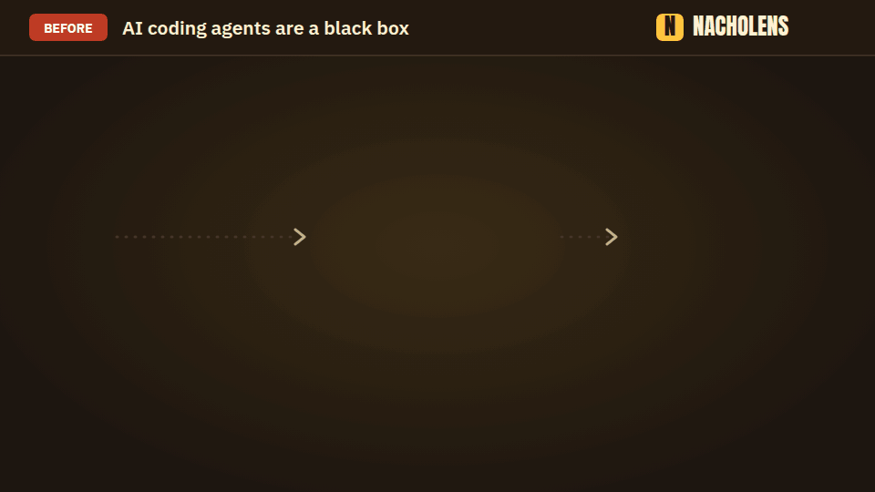
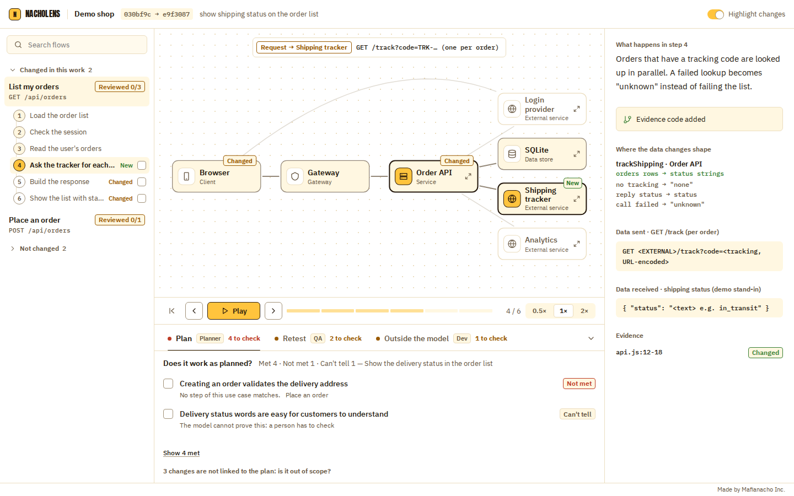

# nacholens

[English](README.md) · [日本語](README.ja.md) · [Deutsch](README.de.md) · [Français](README.fr.md) · **中文** · [한국어](README.ko.md)

**AI 智能体编程是个黑盒，nacholens 把它变成白盒。**



你让智能体改代码，拿回来的是一大堆 diff。它动了哪里？有没有新增对外部服务的调用？该重新测试什么？nacholens 用一个页面回答。

不读代码，也能看清 AI 改了后端的哪些地方。nacholens 把一个代码仓库变成一个页面：选一个用例，就能看到请求从客户端经过你的服务、数据库和第三方服务，并根据 `git diff` 高亮显示改动的部分。



## 用法

在要查看的仓库里打开你的 AI 编程助手（Claude Code、Codex、Cursor 等），复制下面的代码块，在 `我的请求：` 一行写下你想看的内容，然后直接粘贴。

```text
请用 nacholens 回答我下面关于这个仓库的请求，结果做成一个我能打开的页面。

我的请求：<在这里写你想看的内容>
深度（可选）：1 仅变更 · 2 概览 · 3 详细（含表和内部）。不写就按我的请求选择，并告诉我选了哪个。

做法：
1. 获取 nacholens 的操作手册和 CLI（需要 Node.js 20+（已在 Node 24 上验证）和 git；不会往这个仓库安装任何东西）：
   npx -y @mafianacho/nacholens@latest install --to "$HOME/.nacholens-skill" --force
2. 阅读 "$HOME/.nacholens-skill/nacholens/SKILL.md" 并照做。CLI 是：
   node "$HOME/.nacholens-skill/nacholens/cli/src/cli.js" <command>
3. 除 .nacholens/ 里的模型外，不要修改这个仓库的任何文件。页面写到 ./nacholens-out。
4. 页面生成后，告诉我它的路径，并用通俗的话说明它展示了什么。
```

请求示例:

- `最近 5 次提交改了什么？我需要重新测试哪些？`
- `展示登录是怎么工作的，从浏览器到数据库。`
- `把这个分支和 main 比较：这次工作涉及了哪些流程？`
- `在 PR 里直接解释 PR #12：图片、改动的流程、需要重新测试的内容。`

## 试试演示

```bash
npx -y @mafianacho/nacholens@latest demo
# → ./nacholens-demo/demo-shop.html（用浏览器打开）
```

## 更多

- [指南](docs/guide.md)（英文）：命令、改动叠加的原理、局限
- [助手操作手册](skills/nacholens/SKILL.md)、[模型格式](docs/model-schema.md)、[评审面板](docs/review.md)、[PR 评论](docs/pr.md)
- [参与贡献](CONTRIBUTING.md)、[安全](SECURITY.md)

Apache License 2.0（[`LICENSE`](LICENSE)、[`NOTICE`](NOTICE)）。内嵌字体采用 SIL Open Font License 1.1（[`FONTLOG`](src/player/fonts/FONTLOG.md)）。Made by [Mafianacho Inc.](https://mafianacho.com)
